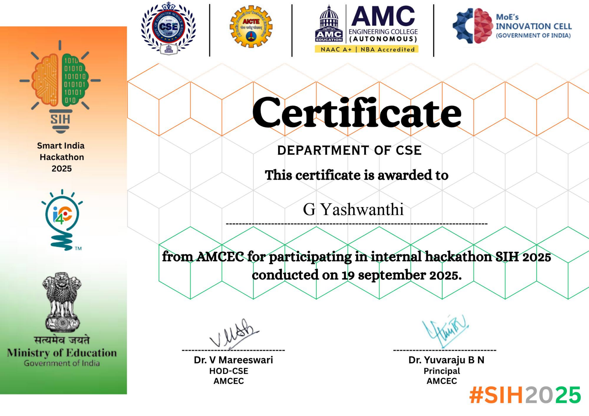

# Smart India Hackathon 2025: Travel Safety

Selected in the first round of Smart India Hackathon 2025 at AMC Engineering
College (internal hackathon, 19 September 2025), working with a team on a
travel safety problem statement. Received a participation certificate.

